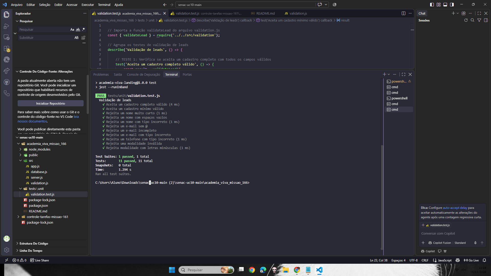

# RELATÓRIO DE TESTES DE SOFTWARE

## 1. Identificação do projeto

| Informação | Descrição |
| --- | --- |
| **Nome do projeto:** | Academia Viva |
| **Resumo do projeto:** | Landing page de uma academia que apresenta cursos e modalidades, permitindo que os visitantes demonstrem interesse por meio de um formulário de cadastro. |
| **Nome do testador:** | Letícia Ribeiro Heidericke |
| **Data dos testes:** | 05/11/2026 |
| **Tecnologias utilizadas:** | JavaScript, Node.js, Jest e NPM |

---

## 2. Objetivo dos testes

**Resposta:**

O objetivo foi testar a função `validateLead`, responsável por validar os dados dos cadastros. Os testes verificaram se os campos estavam preenchidos corretamente, identificando possíveis erros em nomes, e-mails, telefones e modalidades, garantindo que dados inválidos fossem rejeitados.

---

## 3. Ambiente de testes

| Ferramenta/Tecnologia | Versão |
| --- | --- |
| JavaScript | ES6+ |
| Node.js | 18 ou superior |
| Jest | Conforme versão instalada no projeto |
| NPM | Conforme versão instalada no ambiente |
| Outras | Visual Studio Code |

**Comando utilizado para preparar o ambiente:**

```bash
npm install
```

**Comando utilizado para executar o sistema (servidor):**

```bash
npm start
```

**Comando utilizado para executar os testes:**

```bash
npm test
```

---

## 4. Funcionalidades testadas

| Nº | Funcionalidade/Função | Arquivo | Objetivo do teste |
| --- | --- | --- | --- |
| 1 | validateLead | validation.js | Verificar se os dados dos cadastros são válidos. |
| 2 | Validação de nome | validation.js | Verificar o tamanho, os espaços e o tipo do nome. |
| 3 | Validação de e-mail | validation.js | Identificar e-mails inválidos e tipos incorretos. |
| 4 | Validação de telefone | validation.js | Verificar se o telefone informado é um texto. |
| 5 | Validação de modalidade | validation.js | Verificar se a modalidade está na lista permitida. |

---

## 5. Registro detalhado dos testes realizados

### Teste 01 – Cadastro completo válido

- **Funcionalidade testada:** validateLead
- **Nome do teste no Jest:** Aceita um cadastro completo válido.
- **Objetivo:** Verificar se aceita um cadastro com todos os campos preenchidos corretamente.
- **Tipo de cenário:** Positivo.
- **Entrada utilizada:** Nome: Ana Silva; e-mail: ana@email.com; telefone: 27999999999; modalidade: Online.
- **Resultado esperado:** valid = true e errors = [].
- **Resultado obtido:** A confirmar após execução.
- **Status:** A confirmar.

**Código do teste:**

```javascript
test('Aceita um cadastro completo válido', () => {
    const result = validateLead({
        name: 'Ana Silva',
        email: 'ana@email.com',
        phone: '27999999999',
        interest: 'Online'
    });

    expect(result.valid).toBe(true);
    expect(result.errors).toEqual([]);
});
```

---

### Teste 02 – Cadastro mínimo válido

- **Funcionalidade testada:** validateLead
- **Nome do teste no Jest:** Aceita um cadastro mínimo válido.
- **Objetivo:** Verificar se aceita um cadastro contendo apenas os campos obrigatórios.
- **Tipo de cenário:** Positivo.
- **Entrada utilizada:** Nome: Ana Silva; e-mail: ana@email.com.
- **Resultado esperado:** valid = true e errors = [].
- **Resultado obtido:** A confirmar após execução.
- **Status:** A confirmar.

**Código do teste:**

```javascript
test('Aceita um cadastro mínimo válido', () => {
    const result = validateLead({
        name: 'Ana Silva',
        email: 'ana@email.com'
    });

    expect(result.valid).toBe(true);
    expect(result.errors).toEqual([]);
});
```

---

### Teste 03 – Nome muito curto

- **Funcionalidade testada:** validateLead
- **Nome do teste no Jest:** Rejeita um nome muito curto.
- **Objetivo:** Verificar se rejeita nomes com menos de três caracteres.
- **Tipo de cenário:** Limite.
- **Entrada utilizada:** Nome: Al.
- **Resultado esperado:** valid = false.
- **Resultado obtido:** A confirmar após execução.
- **Status:** A confirmar.

**Código do teste:**

```javascript
test('Rejeita um nome muito curto', () => {
    const result = validateLead({
        name: 'Al',
        email: 'ana@email.com'
    });

    expect(result.valid).toBe(false);
    expect(result.errors).toContain(
        'Informe seu nome (mínimo de 3 caracteres).'
    );
});
```

---

### Teste 04 – Nome com espaços vazios

- **Funcionalidade testada:** validateLead
- **Nome do teste no Jest:** Rejeita um nome com espaços vazios.
- **Objetivo:** Verificar se rejeita nomes preenchidos apenas com espaços em branco.
- **Tipo de cenário:** Negativo.
- **Entrada utilizada:** Nome: "     ".
- **Resultado esperado:** valid = false.
- **Resultado obtido:** A confirmar após execução.
- **Status:** A confirmar.

**Código do teste:**

```javascript
test('Rejeita um nome com espaços vazios', () => {
    const result = validateLead({
        name: '     ',
        email: 'ana@email.com'
    });

    expect(result.valid).toBe(false);
    expect(result.errors).toContain(
        'Informe seu nome (mínimo de 3 caracteres).'
    );
});
```

---

### Teste 05 – Nome com tipo incorreto

- **Funcionalidade testada:** validateLead
- **Nome do teste no Jest:** Rejeita um nome com tipo incorreto.
- **Objetivo:** Verificar se rejeita nomes que não sejam textos.
- **Tipo de cenário:** Excepcional.
- **Entrada utilizada:** Nome: 12345.
- **Resultado esperado:** valid = false.
- **Resultado obtido:** A confirmar após execução.
- **Status:** A confirmar.

**Código do teste:**

```javascript
test('Rejeita um nome com tipo incorreto', () => {
    const result = validateLead({
        name: 12345,
        email: 'ana@email.com'
    });

    expect(result.valid).toBe(false);
    expect(result.errors).toContain(
        'Informe seu nome (mínimo de 3 caracteres).'
    );
});
```

---

### Teste 06 – E-mail sem @

- **Funcionalidade testada:** validateLead
- **Nome do teste no Jest:** Rejeita um e-mail sem @.
- **Objetivo:** Verificar se rejeita e-mails sem o símbolo @.
- **Tipo de cenário:** Negativo.
- **Entrada utilizada:** E-mail: anaemail.com.
- **Resultado esperado:** valid = false.
- **Resultado obtido:** A confirmar após execução.
- **Status:** A confirmar.

**Código do teste:**

```javascript
test('Rejeita um e-mail sem @', () => {
    const result = validateLead({
        name: 'Ana Silva',
        email: 'anaemail.com'
    });

    expect(result.valid).toBe(false);
    expect(result.errors).toContain('Informe um e-mail válido.');
});
```

---

### Teste 07 – E-mail incompleto

- **Funcionalidade testada:** validateLead
- **Nome do teste no Jest:** Rejeita um e-mail incompleto.
- **Objetivo:** Verificar se rejeita e-mails sem domínio completo e sem ponto.
- **Tipo de cenário:** Negativo.
- **Entrada utilizada:** E-mail: email@email.
- **Resultado esperado:** valid = false.
- **Resultado obtido:** A confirmar após execução.
- **Status:** A confirmar.

**Código do teste:**

```javascript
test('Rejeita um e-mail incompleto', () => {
    const result = validateLead({
        name: 'Ana Silva',
        email: 'email@email'
    });

    expect(result.valid).toBe(false);
    expect(result.errors).toContain('Informe um e-mail válido.');
});
```

---

### Teste 08 – E-mail com tipo incorreto

- **Funcionalidade testada:** validateLead
- **Nome do teste no Jest:** Rejeita um e-mail com tipo incorreto.
- **Objetivo:** Verificar se rejeita e-mails que não sejam textos.
- **Tipo de cenário:** Excepcional.
- **Entrada utilizada:** E-mail: 12345.
- **Resultado esperado:** valid = false.
- **Resultado obtido:** A confirmar após execução.
- **Status:** A confirmar.

**Código do teste:**

```javascript
test('Rejeita um e-mail com tipo incorreto', () => {
    const result = validateLead({
        name: 'Ana Silva',
        email: 12345
    });

    expect(result.valid).toBe(false);
    expect(result.errors).toContain('Informe um e-mail válido.');
});
```

---

### Teste 09 – Telefone com tipo incorreto

- **Funcionalidade testada:** validateLead
- **Nome do teste no Jest:** Rejeita um telefone com tipo incorreto.
- **Objetivo:** Verificar se rejeita telefones enviados como números em vez de textos.
- **Tipo de cenário:** Excepcional.
- **Entrada utilizada:** Telefone: 27999999999 (numérico).
- **Resultado esperado:** valid = false.
- **Resultado obtido:** A confirmar após execução.
- **Status:** A confirmar.

**Código do teste:**

```javascript
test('Rejeita um telefone com tipo incorreto', () => {
    const result = validateLead({
        name: 'Ana Silva',
        email: 'ana@email.com',
        phone: 27999999999
    });

    expect(result.valid).toBe(false);
    expect(result.errors).toContain('O telefone deve ser um texto.');
});
```

---

### Teste 10 – Modalidade inválida

- **Funcionalidade testada:** validateLead
- **Nome do teste no Jest:** Rejeita uma modalidade inválida.
- **Objetivo:** Verificar se rejeita modalidades que não estão na lista permitida.
- **Tipo de cenário:** Negativo.
- **Entrada utilizada:** Modalidade: Híbrido.
- **Resultado esperado:** valid = false.
- **Resultado obtido:** A confirmar após execução.
- **Status:** A confirmar.

**Código do teste:**

```javascript
test('Rejeita uma modalidade inválida', () => {
    const result = validateLead({
        name: 'Ana Silva',
        email: 'ana@email.com',
        interest: 'Híbrido'
    });

    expect(result.valid).toBe(false);
    expect(result.errors).toContain(
        'Selecione uma modalidade válida.'
    );
});
```

---

### Teste 11 – Modalidade com diferenciação de caixa

- **Funcionalidade testada:** validateLead
- **Nome do teste no Jest:** Rejeita modalidade com letras minúsculas.
- **Objetivo:** Verificar se diferencia letras maiúsculas e minúsculas na modalidade.
- **Tipo de cenário:** Negativo.
- **Entrada utilizada:** Modalidade: online.
- **Resultado esperado:** valid = false.
- **Resultado obtido:** A confirmar após execução.
- **Status:** A confirmar.

**Código do teste:**

```javascript
test('Rejeita modalidade com letras minúsculas', () => {
    const result = validateLead({
        name: 'Ana Silva',
        email: 'ana@email.com',
        interest: 'online'
    });

    expect(result.valid).toBe(false);
    expect(result.errors).toContain(
        'Selecione uma modalidade válida.'
    );
});
```

---

## 6. Resumo dos resultados

| Indicador | Quantidade |
| --- | ---: |
| Total de testes planejados | 11 |
| Testes executados | A confirmar |
| Testes aprovados (Passed) | A confirmar |
| Testes reprovados (Failed) | A confirmar |

**Percentual de aprovação:**

Será calculado após a execução dos testes:

(Testes aprovados ÷ Total de testes executados) × 100.

---

## 7. Evidências da execução dos testes

As evidências devem apresentar capturas de tela que comprovem a execução dos testes no ambiente de desenvolvimento.

Incluir:

- Captura da execução dos testes no Jest.
- Quantidade de testes aprovados e reprovados.
- Mensagens de erro, caso existam.
- Correções realizadas após a identificação de falhas, se aplicável.


---

## 8. Problemas identificados e correções realizadas

| Problema identificado | Causa do problema | Solução implementada | Situação |
| --- | --- | --- | --- |
| Nomes com menos de 3 caracteres eram aceitos. | A validação anterior permitia nomes com apenas 2 caracteres. | Alteração do limite mínimo para 3 caracteres. | Resolvido |
| E-mails incompletos poderiam ser informados. | Necessidade de verificar o formato do e-mail. | Utilização de expressão regular para validar o e-mail. | Resolvido |
| Modalidades com letras minúsculas não eram reconhecidas como válidas. | O JavaScript diferencia letras maiúsculas e minúsculas. | Manutenção da comparação exata com as modalidades permitidas. | Resolvido |

**Resposta:**

Foram identificados pontos que precisavam de ajustes na validação dos dados. As correções foram realizadas para garantir que nomes, e-mails e modalidades fossem verificados corretamente antes de aceitar um cadastro.

---

## 9. Análise dos resultados

**1. Todos os testes apresentaram os resultados esperados? Justifique.**

A confirmação depende da execução final. Os testes foram desenvolvidos para verificar se a função aceita dados válidos e rejeita informações incorretas.

**2. Quais foram os cenários mais importantes verificados durante os testes?**

Os cenários mais importantes foram a validação de nomes, e-mails, telefones e modalidades, incluindo dados incompletos, tipos incorretos e diferenças entre letras maiúsculas e minúsculas.

**3. Algum teste identificou uma falha na aplicação? Qual?**

Foram identificados pontos que precisavam de ajustes, principalmente no tamanho mínimo do nome e na validação dos dados informados.

**4. Quais alterações foram necessárias para corrigir os problemas encontrados?**

Foi ajustado o limite mínimo do nome para três caracteres e mantida a validação do formato do e-mail e das modalidades permitidas.

**5. Existem funcionalidades que ainda precisam ser testadas? Quais?**

Sim. Outras funcionalidades da aplicação, como o envio do formulário, a integração com o banco de dados e os filtros de cursos, também podem receber testes específicos.

---

## 10. Conclusão

**Conclusão da equipe:**

Os testes de software foram importantes para verificar o funcionamento da função validateLead e identificar possíveis falhas na validação dos cadastros. Por meio dos testes unitários, foi possível avaliar diferentes situações, incluindo dados válidos e inválidos. Esse processo contribui para melhorar a qualidade, a segurança e a confiabilidade do sistema.

---

**Relatório elaborado por:** Letícia Ribeiro Heidericke

**Data da última atualização:** 05/11/2026
